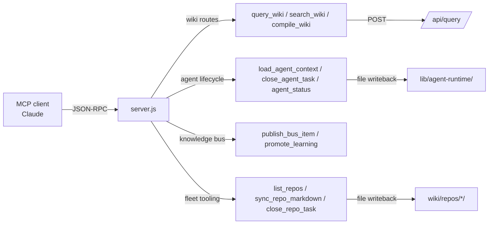

# [[mcp-ecosystem]] Ecosystem

The [[mcp-ecosystem]] ([[mcp-ecosystem]]) ecosystem encompasses the servers, clients, and tooling that expose structured capabilities to LLM agents via JSON-RPC.

## Agentic-KB's [[mcp-ecosystem]] Server

This repo's own [[mcp-ecosystem]] server lives at `mcp/server.js` (package `agentic-kb-mcp`) and exposes **37 tools** so Claude (or any [[mcp-ecosystem]]-compatible client) can directly interact with the knowledge base, the agent runtime, and the cross-repo fleet registry. This grew substantially from the 7-tool wiki-only surface the page previously described — the `ingest_raw` tool from that earlier version no longer exists; raw-document ingestion is now reached through `compile_wiki` and the agent/repo task-lifecycle tools below.

> Correction: an earlier version of this page attributed `mcp/server.js` to a project called `oh-my-mermaid`. That's a mix-up — `oh-my-mermaid` is an unrelated, separately-installed architecture-diagram viewer referenced elsewhere in this repo's docs. The MCP server here belongs to Agentic-KB itself.

### Tool groups

| Group | Count | Examples |
|---|---|---|
| Wiki read/query/compile | 7 | `search_wiki`, `read_article`, `read_index`, `list_articles`, `query_wiki`, `compile_wiki`, `lint_wiki` |
| Agent task lifecycle (vault-scoped) | 12 | `load_agent_context`, `close_agent_task`, `agent_start_task`, `agent_active_task`, `agent_status`, `agent_verify_state`, `agent_repair_state`, `agent_append_task_state`, `agent_abandon_task`, `agent_dry_run_close_task`, `agent_trace`, `list_agents` |
| Knowledge bus & learning promotion (vault-scoped) | 4 | `publish_bus_item`, `list_agent_bus_items`, `promote_learning`, `merge_rewrite` |
| Cross-repo fleet tooling | 14 | `list_repos`, `get_repo_home`, `sync_repo_markdown`, `search_repo_docs`, `load_repo_context`, `append_repo_progress`, `write_repo_task_log`, `close_repo_task`, `dry_run_close_repo_task`, `write_rewrite_artifact`, `publish_repo_discovery`, `publish_repo_escalation`, `list_repo_bus_items`, `promote_repo_learning` |

The cross-repo group mirrors the vault-scoped agent/knowledge-bus tools but operates on the fleet of tracked repos (`wiki/repos/<repo>/...`) instead of the KB vault itself — e.g. `close_repo_task` is `close_agent_task`'s repo-scoped counterpart, `promote_repo_learning` mirrors `promote_learning`, and so on. This 1:1 shape across the two groups is the main structural fact worth remembering about this server, more so than the exact tool count, which has grown twice already (7 → ~20s → 37) as the agent runtime and fleet features were added.

Each tool remains a **thin wrapper**: wiki tools call the corresponding `/api/` route in `web/`, and most task-lifecycle/bus tools write directly to structured files under the vault (`state/`, `wiki/_meta/`, `wiki/repos/<repo>/`) rather than going through an HTTP layer — the "protocol translation only, no business logic" design principle still holds, but the business logic itself now spans both the web API and a set of file-writeback modules in `lib/agent-runtime/`, not only `web/`.

### Architecture

### Design Principle

The [[mcp-ecosystem]] server acts as a protocol translation layer — JSON-RPC in, either HTTP API calls or direct structured-file writes out. This keeps each individual tool thin and testable even as the total tool surface has grown well beyond the original wiki-only scope.

## See Also

- [MCP Framework](../frameworks/framework-mcp.md)
- [LLM-Owned Wiki](../concepts/llm-owned-wiki.md)
- [Tool Use](../concepts/tool-use.md)
- [Agent Loops](../concepts/agent-loops.md)
